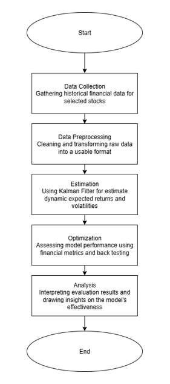
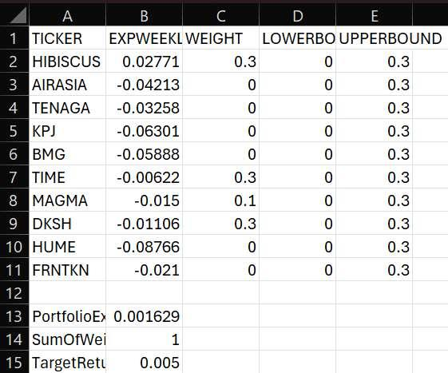
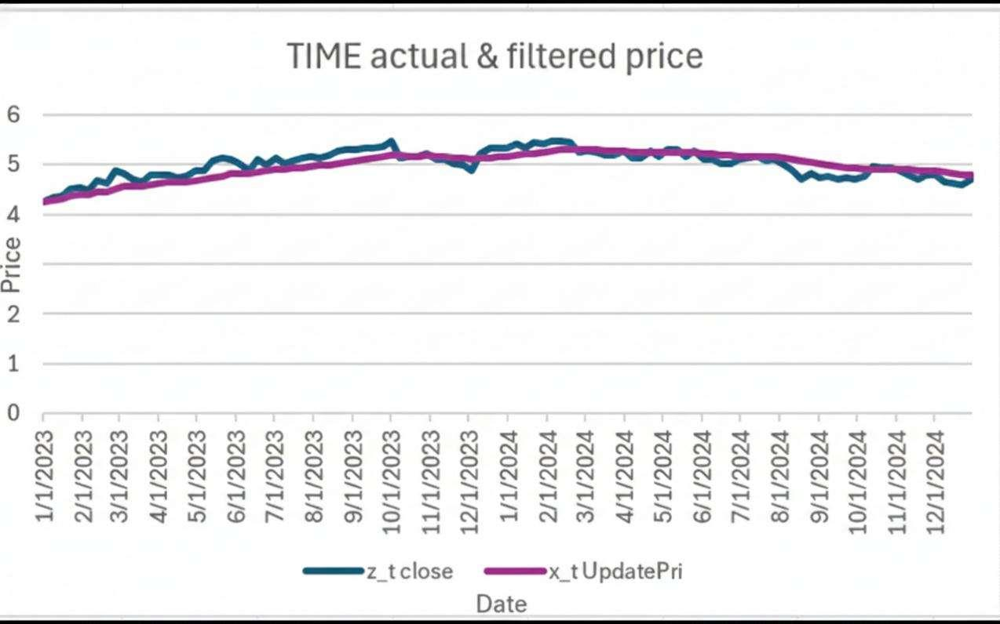
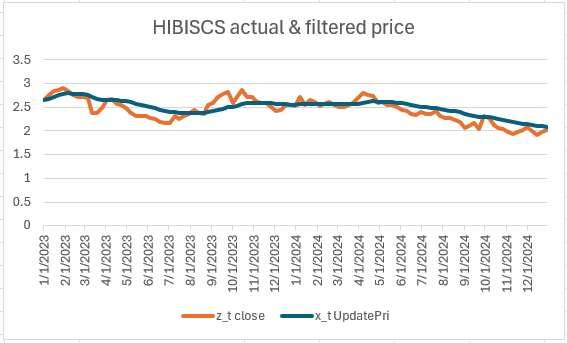
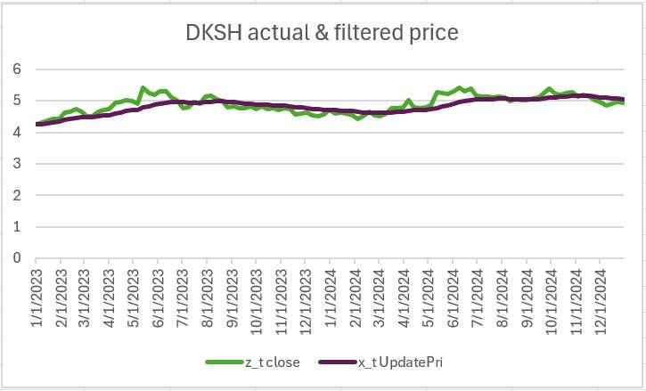

# Selection of Shariah-Compliant Portfolios Using Kalman Filter and Linear Programming

Final Year Project (`P07S25`) — Universiti Teknologi MARA (UiTM), January 2026[cite: 1, 2].  
**Authors:** Aidil Naim Bin Mohamad Khir & Awangku Habil Akhtar Bin Awang Hidzel[cite: 2, 4]  
**Supervisor:** Dr. Maznah Banu Binti Mohamed Habiboo Raman[cite: 3]  
**Programmes:** BSc (Hons.) Management Mathematics & BBA (Hons.) Business Economics[cite: 2, 4]

## Overview

This project combines a **local-level Kalman Filter** for dynamic weekly return estimation with **Linear Programming (Simplex via Excel Solver)** to allocate capital across **10 Shariah-compliant stocks listed on Bursa Malaysia** from **1 January 2023 to 31 December 2024** (105 weekly observations)[cite: 5, 17, 28, 30, 35, 40].

[cite: 27, 69]

## Selected Shariah-Compliant Stocks (Bursa Malaysia)

| # | Company Name | Ticker | Sector / Focus |
| :- | :--- | :--- | :--- |
| 1 | Hibiscus Petroleum Berhad | `HIBISCS` (5199) | Oil & gas exploration and production[cite: 28] |
| 2 | KPJ Healthcare Berhad | `KPJ` (5878) | Healthcare services & hospital management[cite: 28] |
| 3 | Tenaga Nasional Berhad | `TENAGA` (5347) | Electricity utility & energy generation[cite: 28] |
| 4 | Magma Group Berhad | `MAGMA` (7243) | Investment holding (hospitality & technology)[cite: 28] |
| 5 | DKSH Holdings (Malaysia) Berhad | `DKSH` (5908) | Market expansion services & distribution[cite: 28] |
| 6 | TIME dotCom Berhad | `TIMECOM` (5031) | Telecommunications & data solutions[cite: 29] |
| 7 | Hume Cement Industries Berhad | `HUMEIND` (5000) | Construction materials & cement manufacturing[cite: 29] |
| 8 | BM Greentech Berhad | `BMGREEN` (0168) | Green technology & industrial boilers[cite: 29] |
| 9 | AirAsia X Berhad | `AAX` (5238) | Long-haul low-cost aviation & travel[cite: 29] |
| 10 | Frontken Corporation Berhad | `FRONTKN` (0128) | Engineering services & surface metamorphosis[cite: 29] |

## Methodology & Optimization Constraints

1. **Kalman Filter Estimation:** Uses weekly percentage returns from closing prices with a state-space local-level model ($F = 1$, $H = 1$), initialized at $x_0 = 0$ and $P_0 = 1$, with empirical noise parameters $R = 2 \times \text{SD}(P_t)$ and $Q = 0.01 \times R$.
2. **Linear Programming Formulation:** Maximizes portfolio expected return $Z = \sum_{i=1}^{10} w_i E[R_i]$ subject to:
   * **Full investment:** $\sum_{i=1}^{10} w_i = 1$
   * **Diversification cap:** $0 \le w_i \le 0.30$ per stock
   * **Shariah long-only rule:** $w_i \ge 0$ (no short selling)

## Key Results & Visuals

* **Optimal Weights:** `HIBISCS` (30%), `TIMECOM` (30%), `DKSH` (30%), and `MAGMA` (10%), with 0% weight assigned to the remaining six stocks[cite: 47, 48].
* **Takeaway:** The Kalman Filter smooths short-term price noise (especially clear on stable counters like `TIMECOM` and `DKSH`), while the LP optimizer acts as a defensive filter in softer markets[cite: 42, 44, 48, 49].

[cite: 47, 62]
[cite: 42, 67]
[cite: 44, 66]
[cite: 44, 65]
